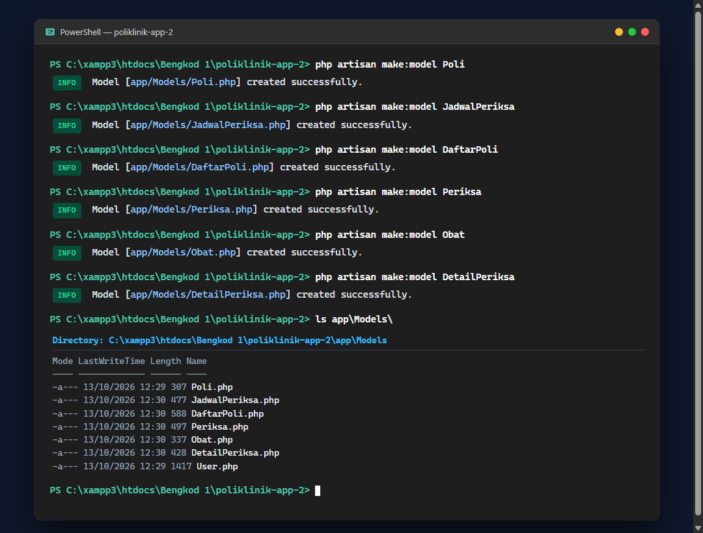
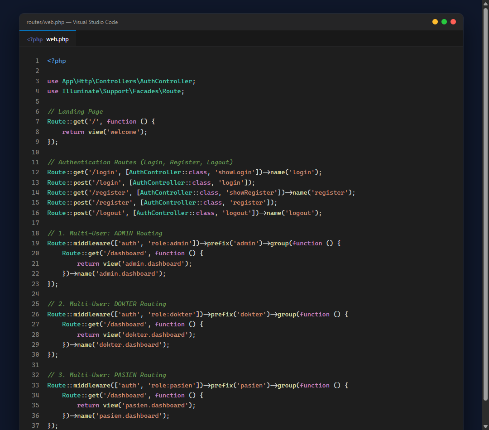
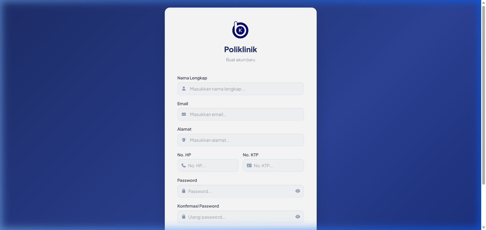
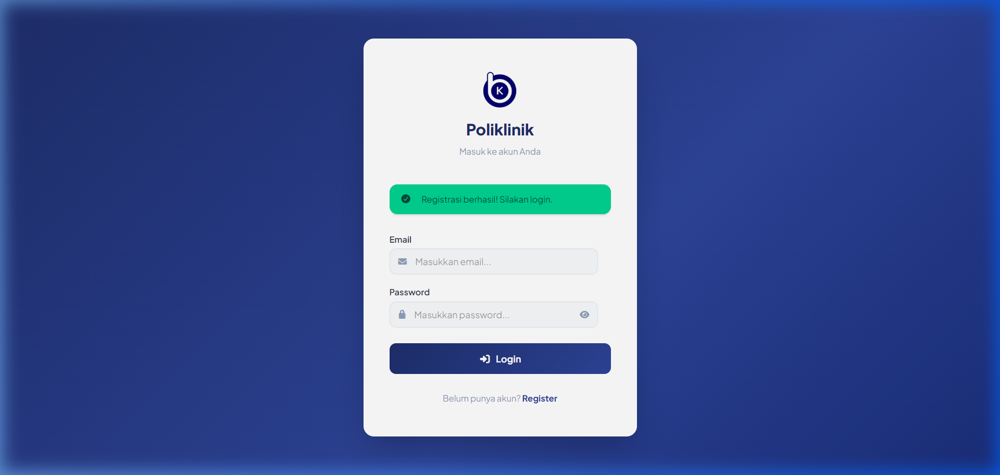
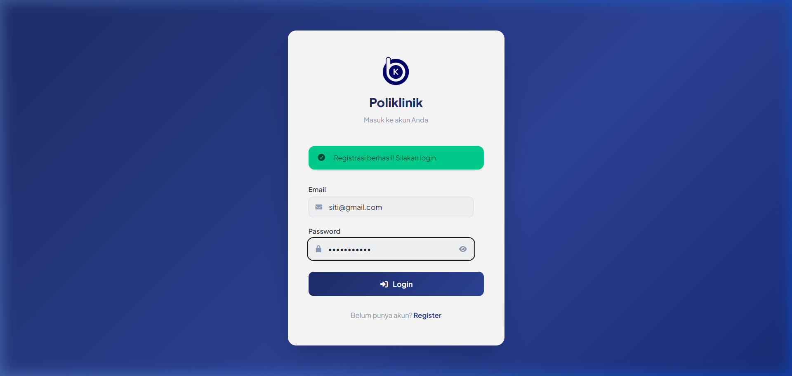
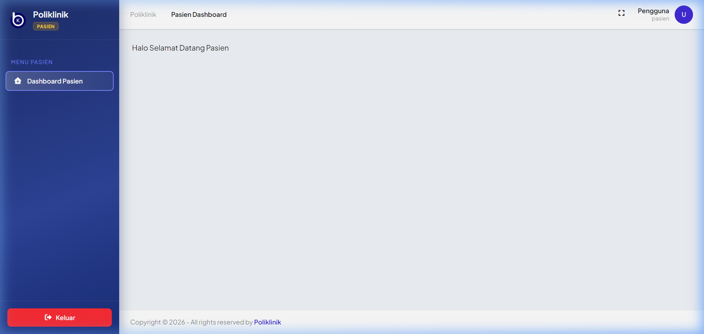
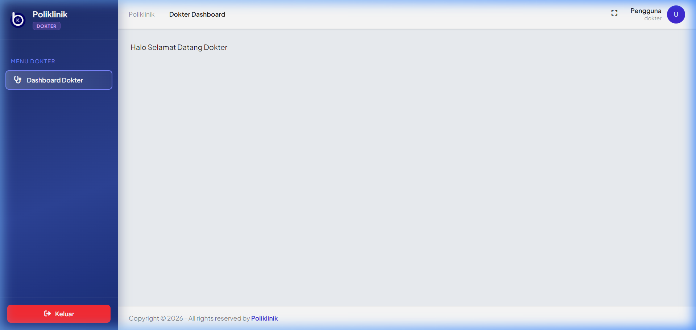
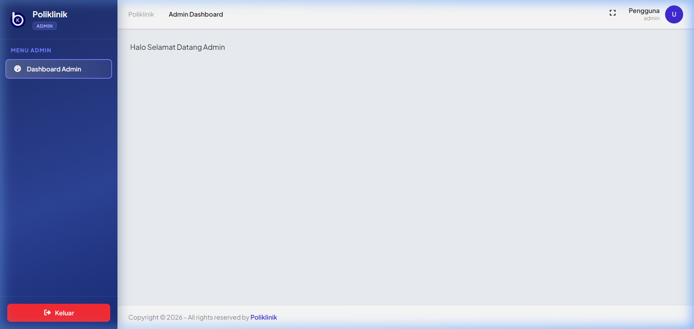

# Laporan Pengerjaan & Dokumentasi Aplikasi Poliklinik

Proyek Sistem Informasi Poliklinik berbasis **Laravel 11**, dilengkapi dengan sistem multi-user authentication (Pasien, Dokter, Admin), database Eloquent models & relasi, serta UI modern.

---

## Daftar Isi
1. [Hasil Eksekusi Pembuatan Model](#1-hasil-eksekusi-pembuatan-model)
2. [Routing Multi-User (`routes/web.php`)](#2-routing-multi-user-routeswebphp)
3. [Bukti Fungsi Fitur Register & Login](#3-bukti-fungsi-fitur-register--login)
4. [Akun Pengujian (Seeder Kredensial)](#4-akun-pengujian-default)
5. [Cara Menjalankan Proyek](#5-cara-menjalankan-proyek)

---

## 1. Hasil Eksekusi Pembuatan Model
Pembuatan 6 model Eloquent dilakukan melalui terminal menggunakan perintah Artisan:
- `php artisan make:model Poli`
- `php artisan make:model JadwalPeriksa`
- `php artisan make:model DaftarPoli`
- `php artisan make:model Periksa`
- `php artisan make:model Obat`
- `php artisan make:model DetailPeriksa`

### Bukti Screenshot Eksekusi Terminal:


### Rincian Model yang Dibuat di `app/Models/`:
| No | Model | Tabel Database | Relasi Utama |
|---|---|---|---|
| 1 | `Poli` | `poli` | `hasMany(User::class, 'id_poli')` |
| 2 | `JadwalPeriksa` | `jadwal_periksa` | `belongsTo(User::class, 'id_dokter')`, `hasMany(DaftarPoli::class, 'id_jadwal')` |
| 3 | `DaftarPoli` | `daftar_poli` | `belongsTo(User::class, 'id_pasien')`, `belongsTo(JadwalPeriksa::class, 'id_jadwal')`, `hasMany(Periksa::class, 'id_daftar_poli')` |
| 4 | `Periksa` | `periksa` | `belongsTo(DaftarPoli::class, 'id_daftar_poli')`, `hasMany(DetailPeriksa::class, 'id_periksa')` |
| 5 | `Obat` | `obat` | `hasMany(DetailPeriksa::class, 'id_obat')` |
| 6 | `DetailPeriksa` | `detail_periksa` | `belongsTo(Periksa::class, 'id_periksa')`, `belongsTo(Obat::class, 'id_obat')` |

---

## 2. Routing Multi-User (`routes/web.php`)
Routing multi-user dipisahkan berdasarkan hak akses (`role:admin`, `role:dokter`, `role:pasien`) menggunakan middleware `auth` dan `role` (`App\Http\Middleware\RoleMiddleware`).

### Bukti Screenshot `routes/web.php`:


### Kode Lengkap `routes/web.php`:
```php
<?php

use App\Http\Controllers\AuthController;
use Illuminate\Support\Facades\Route;

// Landing Page
Route::get('/', function () {
    return view('welcome');
});

// Authentication Routes
Route::get('/login', [AuthController::class, 'showLogin'])->name('login');
Route::post('/login', [AuthController::class, 'login']);
Route::get('/register', [AuthController::class, 'showRegister'])->name('register');
Route::post('/register', [AuthController::class, 'register']);
Route::post('/logout', [AuthController::class, 'logout'])->name('logout');

// 1. Multi-User: ADMIN Routing
Route::middleware(['auth', 'role:admin'])->prefix('admin')->group(function () {
    Route::get('/dashboard', function () {
        return view('admin.dashboard');
    })->name('admin.dashboard');
});

// 2. Multi-User: DOKTER Routing
Route::middleware(['auth', 'role:dokter'])->prefix('dokter')->group(function () {
    Route::get('/dashboard', function () {
        return view('dokter.dashboard');
    })->name('dokter.dashboard');
});

// 3. Multi-User: PASIEN Routing
Route::middleware(['auth', 'role:pasien'])->prefix('pasien')->group(function () {
    Route::get('/dashboard', function () {
        return view('pasien.dashboard');
    })->name('pasien.dashboard');
});
```

---

## 3. Bukti Fungsi Fitur Register & Login

### A. Halaman Form Registrasi Pasien Baru
Form pendaftaran pasien baru lengkap dengan input nama lengkap, email, alamat, no. HP, no. KTP, dan password. Nomor Rekam Medis (`no_rm`) otomatis di-generate oleh sistem.


### B. Registrasi Berhasil & Flash Alert Sukses
Setelah form dikirim, data tersimpan ke database `users` dengan `role = 'pasien'` dan dialihkan ke halaman login dengan notifikasi hijau: *"Registrasi berhasil! Silakan login."*


### C. Halaman Login
Pengguna memasukkan email dan password yang telah didaftarkan.


### D. Dashboard Pasien (Akses Role Pasien)
Setelah login, pengguna dengan role pasien diarahkan ke `/pasien/dashboard`.


### E. Dashboard Dokter (Akses Role Dokter)
Login dengan akun dokter diarahkan ke `/dokter/dashboard`.


### F. Dashboard Admin (Akses Role Admin)
Login dengan akun admin diarahkan ke `/admin/dashboard`.


---

## 4. Akun Pengujian Default
Data user default yang tersedia dari database seeder (`UserSeeder`):

| Role | Email | Password | URL Dashboard |
|---|---|---|---|
| **Admin** | `admin@gmail.com` | `admin` | `/admin/dashboard` |
| **Dokter** | `dokter@gmail.com` | `dokter` | `/dokter/dashboard` |
| **Pasien** | `pasien@gmail.com` | `pasien` | `/pasien/dashboard` |

---

## 5. Cara Menjalankan Proyek
1. Clone repositori:
   ```bash
   git clone https://github.com/RonnanDinar/Bengkod.git
   ```
2. Salin environment file & install dependensi:
   ```bash
   cp .env.example .env
   composer install
   npm install
   ```
3. Generate application key:
   ```bash
   php artisan key:generate
   ```
4. Jalankan migrasi & seeder database:
   ```bash
   php artisan migrate --seed
   ```
5. Build asset frontend:
   ```bash
   npm run build
   ```
6. Jalankan server lokal:
   ```bash
   php artisan serve
   ```
   Akses aplikasi di browser pada: `http://127.0.0.1:8000/login`
