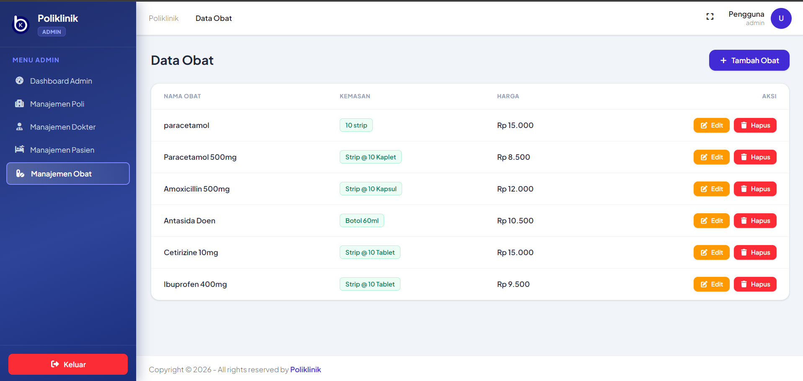
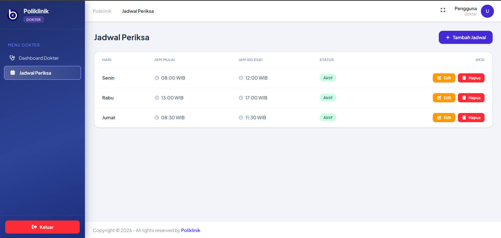

# Dokumentasi Pengerjaan Penugasan CRUD Poliklinik

Dokumentasi ini merangkum perubahan dan penambahan fitur pada sistem aplikasi Poliklinik berbasis **Laravel 12**:
1. **CRUD Manajemen Obat** untuk role **Admin** (Materi Bab 1)
2. **CRUD Jadwal Periksa** untuk role **Dokter** (Materi Bab 3)
3. **Navigasi Sidebar Dinamis** dengan pendeteksian rute aktif

---

## Daftar Isi
1. [Akun Pengujian (Kredensial Default)](#1-akun-pengujian-kredensial-default)
2. [Arsitektur Perutean (routes/web.php)](#2-arsitektur-perutean-routeswebphp)
3. [Fitur CRUD Obat (Role Admin - Bab 1)](#3-fitur-crud-obat-role-admin---bab-1)
4. [Fitur CRUD Jadwal Periksa (Role Dokter - Bab 3)](#4-fitur-crud-jadwal-periksa-role-dokter---bab-3)
5. [Navigasi Sidebar Dinamis (sidebar.blade.php)](#5-navigasi-sidebar-dinamis-sidebarbladephp)
6. [Panduan Menjalankan Aplikasi](#6-panduan-menjalankan-aplikasi)

---

## 1. Akun Pengujian (Kredensial Default)

Untuk menguji fitur yang dibuat, gunakan kredensial berikut:

| Role | Email | Password | URL Akses |
|---|---|---|---|
| **Admin** | `admin@gmail.com` | `admin` | `http://127.0.0.1:8000/admin/obat` |
| **Dokter** | `dokter@gmail.com` | `dokter` | `http://127.0.0.1:8000/dokter/jadwal-periksa` |

---

## 2. Arsitektur Perutean (`routes/web.php`)

Perutean resource untuk modul **Obat** dan **Jadwal Periksa** didaftarkan di dalam grup middleware sesuai hak akses peran (*role-based access control*):

```php
// 1. Role Dokter - Resource Jadwal Periksa
Route::middleware(['auth', 'role:dokter'])->prefix('dokter')->group(function () {
    Route::get('/dashboard', function () {
        return view('dokter.dashboard');
    })->name('dokter.dashboard');
    Route::resource('jadwal-periksa', JadwalPeriksaController::class);
});

// 2. Role Admin - Resource Obat
Route::middleware(['auth', 'role:admin'])->prefix('admin')->group(function () {
    Route::get('/dashboard', function () {
        return view('admin.dashboard');
    })->name('admin.dashboard');
    Route::resource('polis', AdminPoliController::class);
    Route::resource('dokter', DokterController::class);
    Route::resource('pasien', PasienController::class);
    Route::resource('obat', ObatController::class);
});
```

---

## 3. Fitur CRUD Obat (Role Admin - Bab 1)

Modul ini memberikan akses penuh bagi Admin untuk mengelola data obat poliklinik.

### A. Berkas yang Dibuat & Dimodifikasi:
* **Model:** [`app/Models/Obat.php`](file:///c:/xampp3/htdocs/Bengkod%201/poliklinik-app-4/app/Models/Obat.php)
* **Controller:** [`app/Http/Controllers/Admin/ObatController.php`](file:///c:/xampp3/htdocs/Bengkod%201/poliklinik-app-4/app/Http/Controllers/Admin/ObatController.php)
* **Route:** `Route::resource('obat', ObatController::class);` di `routes/web.php`
* **Sidebar Menu:** Menu *"Manajemen Obat"* di [`sidebar.blade.php`](file:///c:/xampp3/htdocs/Bengkod%201/poliklinik-app-4/resources/views/components/partials/sidebar.blade.php)
* **Views:**
  - [`resources/views/admin/obat/index.blade.php`](file:///c:/xampp3/htdocs/Bengkod%201/poliklinik-app-4/resources/views/admin/obat/index.blade.php) (Tabel data obat)
  - [`resources/views/admin/obat/create.blade.php`](file:///c:/xampp3/htdocs/Bengkod%201/poliklinik-app-4/resources/views/admin/obat/create.blade.php) (Formulir tambah obat)
  - [`resources/views/admin/obat/edit.blade.php`](file:///c:/xampp3/htdocs/Bengkod%201/poliklinik-app-4/resources/views/admin/obat/edit.blade.php) (Formulir edit data obat)

### B. Penjelasan Logika & Validasi Controller:
* **`index()`**: Mengambil data seluruh obat (`Obat::all()`) dan mengirimkannya ke view daftar obat.
* **`create()`**: Menampilkan formulir input penambahan obat baru.
* **`store(Request $request)`**: Memvalidasi input lalu menyimpan obat baru:
  ```php
  $request->validate([
      'nama_obat' => 'required|string',
      'kemasan' => 'required|string',
      'harga' => 'required|integer',
  ]);
  ```
* **`edit(string $id)`**: Mengambil data obat berdasarkan ID (`Obat::findOrFail($id)`) dan menampilkan formulir ubah.
* **`update(Request $request, string $id)`**: Memvalidasi perubahan dan memperbarui baris data obat terkait.
* **`destroy(string $id)`**: Menghapus data obat terpilih dari basis data dengan konfirmasi aksi.

### C. Screenshot Halaman Daftar Obat:
Tangkapan layar halaman **Daftar Obat** menampilkan:
- Tabel data obat lengkap (`NAMA OBAT`, `KEMASAN`, `HARGA`, `AKSI`)
- Menu sidebar **"Manajemen Obat"** dalam keadaan **aktif** (highlight border & background gradient)
- URL halaman browser: `http://127.0.0.1:8000/admin/obat`



---

## 4. Fitur CRUD Jadwal Periksa (Role Dokter - Bab 3)

Modul ini memungkinkan dokter mengelola jadwal praktiknya secara mandiri.

### A. Berkas yang Dibuat & Dimodifikasi:
* **Model:** [`app/Models/JadwalPeriksa.php`](file:///c:/xampp3/htdocs/Bengkod%201/poliklinik-app-4/app/Models/JadwalPeriksa.php)
* **Controller:** [`app/Http/Controllers/Dokter/JadwalPeriksaController.php`](file:///c:/xampp3/htdocs/Bengkod%201/poliklinik-app-4/app/Http/Controllers/Dokter/JadwalPeriksaController.php)
* **Route:** `Route::resource('jadwal-periksa', JadwalPeriksaController::class);` di `routes/web.php`
* **Sidebar Menu:** Menu *"Jadwal Periksa"* di [`sidebar.blade.php`](file:///c:/xampp3/htdocs/Bengkod%201/poliklinik-app-4/resources/views/components/partials/sidebar.blade.php)
* **Views:**
  - [`resources/views/dokter/jadwal-periksa/index.blade.php`](file:///c:/xampp3/htdocs/Bengkod%201/poliklinik-app-4/resources/views/dokter/jadwal-periksa/index.blade.php) (Tabel jadwal periksa)
  - [`resources/views/dokter/jadwal-periksa/create.blade.php`](file:///c:/xampp3/htdocs/Bengkod%201/poliklinik-app-4/resources/views/dokter/jadwal-periksa/create.blade.php) (Formulir tambah jadwal)
  - [`resources/views/dokter/jadwal-periksa/edit.blade.php`](file:///c:/xampp3/htdocs/Bengkod%201/poliklinik-app-4/resources/views/dokter/jadwal-periksa/edit.blade.php) (Formulir edit jadwal)

### B. Penjelasan Logika & Keamanan Data (Scoping Dokter):
* **Keamanan Data Milik Dokter Login (`Auth::id()`):**
  Setiap dokter hanya dapat melihat, menambah, mengubah, dan menghapus jadwal miliknya sendiri:
  ```php
  $jadwals = JadwalPeriksa::where('id_dokter', Auth::id())->get();
  ```
* **Validasi Waktu Praktik:**
  Memastikan jam selesai selalu lebih akhir dari jam mulai:
  ```php
  $request->validate([
      'hari' => 'required|in:Senin,Selasa,Rabu,Kamis,Jumat,Sabtu,Minggu',
      'jam_mulai' => 'required',
      'jam_selesai' => 'required|after:jam_mulai',
  ], [
      'jam_selesai.after' => 'Jam selesai harus lebih akhir dari jam mulai.',
  ]);
  ```

### C. Screenshot Halaman Daftar Jadwal Periksa:
Tangkapan layar halaman **Daftar Jadwal Periksa** menampilkan:
- Tabel data jadwal (`HARI`, `JAM MULAI`, `JAM SELESAI`, `STATUS`, `AKSI`)
- Menu sidebar **"Jadwal Periksa"** dalam keadaan **aktif** (highlight border & background gradient)
- URL halaman browser: `http://127.0.0.1:8000/dokter/jadwal-periksa`



---

## 5. Navigasi Sidebar Dinamis (`sidebar.blade.php`)

Sidebar secara dinamis menandai menu aktif berdasarkan rute yang sedang diakses pengguna menggunakan helper Laravel `request()->routeIs(...)`:

```blade
{{-- Menu Admin: Manajemen Obat --}}
<a href="{{ route('obat.index') }}"
    class="{{ $baseLink }} {{ request()->routeIs('obat.*') ? $active : $inactive }}">
    <i class="fas fa-pills w-4 text-center"></i>
    Manajemen Obat
</a>

{{-- Menu Dokter: Jadwal Periksa --}}
<a href="{{ route('jadwal-periksa.index') }}"
    class="{{ $baseLink }} {{ request()->routeIs('jadwal-periksa.*') ? $active : $inactive }}">
    <i class="fas fa-calendar-days w-4 text-center"></i>
    Jadwal Periksa
</a>
```

Dengan pengecekan berbasis wildcard (`obat.*` dan `jadwal-periksa.*`), menu tetap berstatus aktif baik saat membuka halaman daftar (`index`), formulir tambah (`create`), maupun formulir edit (`edit`).

---

## 6. Panduan Menjalankan Aplikasi

1. **Pastikan Web Server & Database Aktif**:
   Nyalakan modul Apache dan MySQL pada aplikasi XAMPP.

2. **Migrasi Database & Seeder**:
   ```bash
   php artisan migrate --seed
   ```

3. **Kompilasi Aset Frontend (Opsional)**:
   ```bash
   npm run build
   ```

4. **Jalankan Server Lokal**:
   ```bash
   php artisan serve
   ```
   Akses aplikasi di browser pada: **`http://127.0.0.1:8000/login`**
